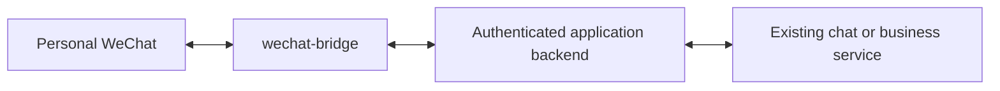

# wechat-bridge

A small, self-hosted transport service for connecting applications to personal WeChat through the ClawBot/iLink protocol. Applications provide the chat or business logic; this bridge handles QR authorization, account connections, text transport, and application-scoped routing.

This is an independent project, not a Tencent product or an official hosted integration. Its protocol implementation follows the [Tencent Weixin channel source](https://github.com/Tencent/openclaw-weixin) and [protocol reference](https://github.com/Tencent/openclaw-weixin/blob/main/docs/protocol.md). A custom bridge must be verified against the actual WeChat account and deployment environment; QR API availability alone does not prove that all account features will work.

## Current scope

- Short-lived, one-use binding invitations associated with an application's user.
- Browser binding page with QR authorization and optional WeChat verification challenges.
- The connection is ready once WeChat confirms QR authorization. The bridge tracks inbound messages and outbound API acceptance separately.
- Separate API credentials and user namespaces for each application.
- Per-account long polling, sender checks, encrypted credentials and message bodies, and persistent message deduplication.
- APIs for reading incoming text events, replying to an event, and sending notifications.
- Local unbinding, connection error reporting, bounded event retention, and process resource limits.

`test` mode replies with fixed connection acknowledgments. It does not call a model or application backend. `relay` mode exposes incoming messages from active bindings to an authorized application's event consumer. No existing application, including Glean, needs modification to test this service independently.



## Requirements and verification

Node.js 24.16 or newer, a public HTTPS origin for the binding page, and a WeChat account that can complete ClawBot authorization. The service itself binds only to `127.0.0.1`; place the supplied Nginx location behind your existing HTTPS server.

```sh
npm ci --ignore-scripts
npm run check
npm test
```

Tests use a fake provider. They verify authorization boundaries, account separation, encrypted storage, deduplication, authorization flow, and failure handling without contacting WeChat or sending real messages.

For deployment, see [deployment instructions](docs/DEPLOYMENT.md). Applications integrate using the [HTTP API](docs/API.md).

For host alerts over WeChat, see the optional [Linux resource monitor](examples/resource-monitor/README.md).

## Important boundaries

1. **One WeChat account has one primary connection.** In relay mode, the primary user can explicitly delegate new inbound texts to one other application using the binding browser. The primary application can still send its own notifications.
2. QR authorization establishes a connection. To verify end-to-end messaging, send a message in WeChat and check for the reply on the phone.
3. ClawBot sending uses conversation context and may require renewed user interaction. This service is not an unconditional, around-the-clock emergency notification channel. Provider quotas, account eligibility and disconnect behavior remain subject to WeChat.
4. This implementation supports **text**. It recognizes other inbound items but does not download media, transcribe voice, support groups, or grant access to unrelated WeChat conversations.
5. Unbinding stops local workers and deletes local account credentials and stored events. It does not claim to revoke an authorization on Tencent's servers; manage provider authorization in WeChat as needed.
6. A multi-account plugin is not a complete public SaaS authorization contract. Verify the provider's supported deployment and distribution model before general public onboarding.

## Secrets and data

Keep configuration, application API credentials, SQLite databases, backups and binding links outside the repository. SQLite message bodies and connection credentials use AES-256-GCM; the separate configuration file contains the encryption key. Application/user mapping and timestamps are metadata, not encrypted columns. The key must be backed up securely with the database and must not be replaced during an upgrade.

Browser invitations expire in 30 minutes, are consumed once, and travel in URL fragments. Browser sessions expire after 24 hours and use a Secure, HttpOnly, SameSite cookie. Credential-bearing provider requests prohibit HTTP redirects and accept only HTTPS Weixin API hosts. Events and request deduplication records are retained for seven days. Unbinding deletes events and credentials and keeps only the request IDs and deduplication metadata for the rest of that window.

Publication does not include runtime configuration, tokens or user messages. A public deployment should also apply its own host maintenance, encrypted backups, and access lifecycle policies.
